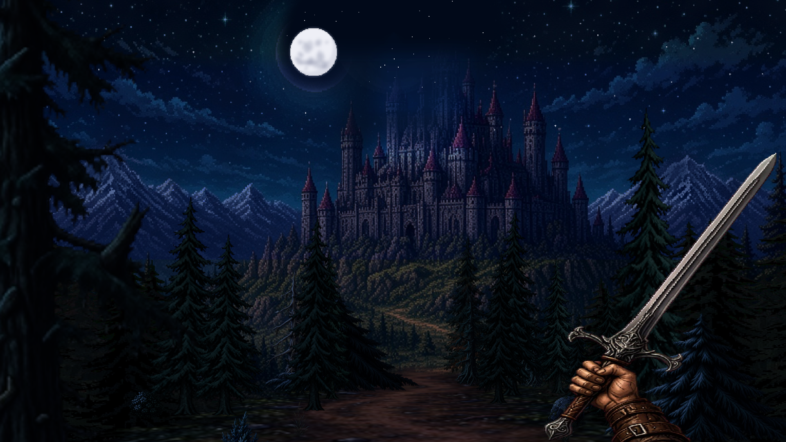
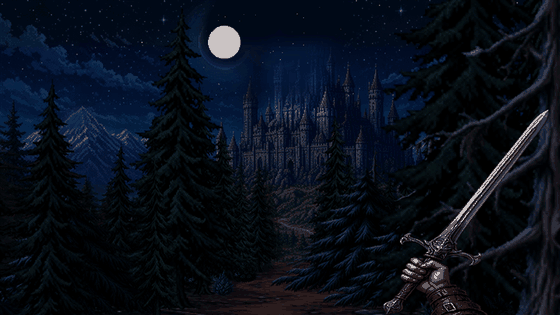
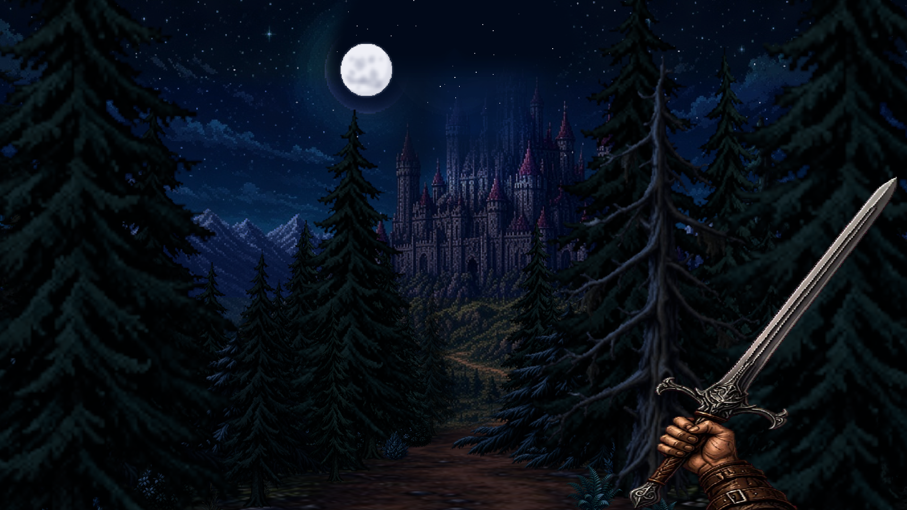
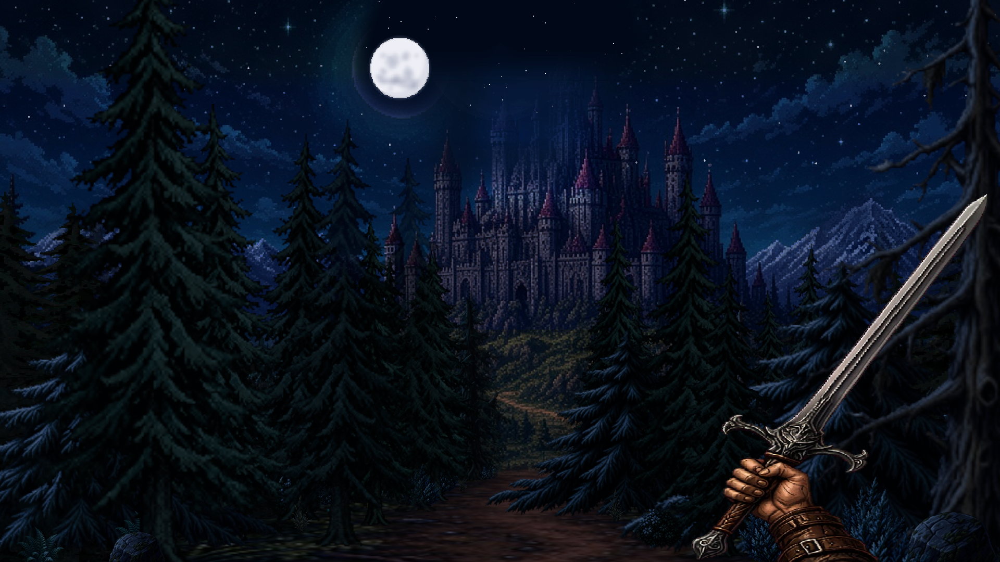
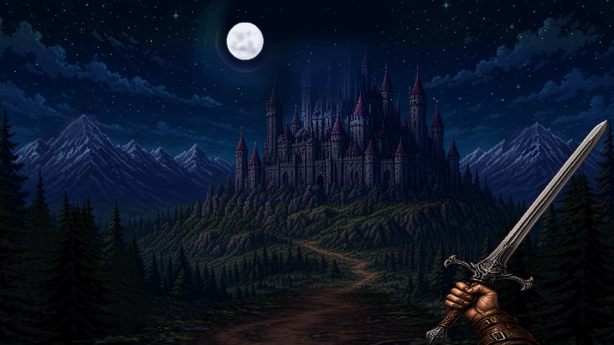

<div align="center">

# The Witcher: Moonlit Road

**A first-person dark-fantasy walk through a pixel-art pine forest towards a moonlit castle, built in Unity 6 + URP.**

*Тёмное фэнтези в пиксель-арте: прогулка по ночному лесу к замку под луной.*




</div>

## About

The Witcher: Moonlit Road is a short atmospheric prototype that carries on the spirit of my earlier
[Java Chapter 1 prototype](https://github.com/top-secret666/the-witcher), rebuilt in **Unity 6 + URP**.

You walk forward along a dirt road at night. The scene is a stack of hand-tuned pixel-art layers
rather than a full 3D world: the distant vista (moon, mountains, castle) stays put, the side pines
**part outward as you walk**, the near road scrolls under your feet, and the roadside trees and
undergrowth pass by in perspective. The further you walk, the more the forest opens up and reveals the castle.

<div align="center">

<br/><sub>Walking forward: the pines part, the road scrolls and the castle comes into view.</sub>
</div>

## Features

- **Walk-driven parallax rig** (`PitchPaperRig`): an L1 vista, L2 side pines that slide outward and grow as you walk, and recycle seamlessly, plus head bob and sword bob.
- **Hill-climb reveal**: distance walked gradually thins the roadside trees and opens the view onto the castle.
- **CPU-projected near road** (`NearRoadLayer`): a perspective dirt road plus depth-sorted roadside trees, bushes, ferns and boulders drawn into UI images. It uses a premultiplied mip chain, per-row mip level and bilinear sampling with fractional scroll for smooth motion.
- **First-person viewmodel**: a pixel sword locked to the camera, with bob that gets stronger when you sprint.
- **Retro look**: a custom URP `ScriptableRendererFeature` (pixelate, dither, posterize) and a low-res pixel camera fallback.
- **Data-driven moods**: `AtmosphereProfile` ScriptableObjects (Castle Dusk, Manor Night, Bright Day) applied by `DarkFantasyAtmosphere`, so no colours are hard-coded in MonoBehaviours.
- **Editor tooling**: menus under **Witcher/** generate materials, profiles and prefabs, rebuild the demo scene from prefabs, and apply art styles.

## Screenshots

| | |
|:---:|:---:|
|  |  |
| Start of the road, deep in the forest | The side pines part as you walk |
|  |  |
| The castle comes into view | Fully open vista |

## Controls

| Input | Action |
|-------|--------|
| `W` / `S` | Walk forward / back (strafe and turning are locked in this pitch scene) |
| `Shift` | Sprint |
| Mouse | Look up / down |
| `Space` | Jump |
| `Esc` | Lock / unlock the cursor |

## Tech highlights

```
Player (FirstPersonController, CharacterController)
 └─ Camera ─ PitchPaperRig (Screen Space Overlay canvas, 1280x720 reference)
              ├─ L1  vista: sky, moon, mountains, castle
              ├─ L2  parting side pines (walk-driven passing, recycled copies)
              ├─ L3  NearRoadLayer: perspective road + roadside trees/undergrowth
              └─ sword viewmodel (head bob / sword bob)
```

- **One speed signal drives everything.** `FirstPersonController.PlanarSpeed` feeds the near road, and the L2 pines read the road's smoothed `CurrentSpeed`, so all layers start and stop together.
- **No custom shader for the road.** It is projected on the CPU into `RawImage`s, so it works on any canvas and keeps point-filtered pixel art crisp.
- **Clean scene architecture.** Fixed hierarchy roots (`SceneRoots`), prefabs instead of loose cubes, and ScriptableObject data for mood. See [`docs/ARCHITECTURE.md`](docs/ARCHITECTURE.md).
- **Namespaces.** `Witcher.Core`, `Witcher.Data`, `Witcher.Environment`, `Witcher.Player`, `Witcher.Visuals`.

## Project structure

```
Assets/Witcher/
  Art/          Materials, Sprites (vista, pines, road, sword), Textures, Reference
  Data/         Atmosphere profiles (ScriptableObjects)
  Editor/       ArchitectureBuilder, PitchPresentationSetup, HybridRetroSetup, ...
  Prefabs/      Castle modules, Pine, Player, Atmosphere
  Scenes/       DarkFantasy_Demo.unity
  Scripts/      Core, Data, Environment, Player, Visuals
  Shaders/      RetroLook.shader
docs/           Architecture notes, art briefs, screenshots
```

## Getting started

1. Install **Unity 6000.6.4f1** (Unity 6) with Windows build support.
2. Clone the repo, then in Unity Hub choose **Add → Add project from disk**.
3. Open `Assets/Witcher/Scenes/DarkFantasy_Demo.unity`.
4. Press **Play** and hold `W`.
